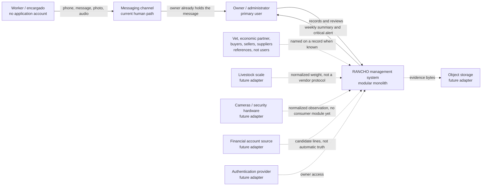

# System context

C4-style context for the ranch management system. Boxes are logical. No product is selected for any external box.

This context is the future management system. The discovery application in `apps/domain-map` is how the team draws AS-IS and TO-BE maps ([ADR-001](adr/ADR-001-domain-maps-as-code.md)). It is not a container in the diagram below.

## What the system is

The system records operational and management facts for one ranch at Balancán, Tabasco, and presents them back to the owner. It is the place where an animal identity, a weight, a feed quantity, a warehouse count, an expense, a sale, a birth, a parentage statement, or a health note becomes a durable fact with a source quality.

It does not replace fiscal accounting (`CON-ACC-001`). It does not, by itself, detect a cut fence (`CON-SEC-001`). It does not require the workers to carry an application account in the first stage (`CON-ENTRY-001`).

## Human actors

An actor in the domain catalog is not automatically a user. Participation is defined in `docs/domain/actors.md`.

| Actor | Relationship to the system in v0.2 |
| --- | --- |
| `ACT-OWNER`, ranch owner / administrator | Primary person who records facts and reads the weekly view and critical alerts. The only actor assumed to have an application access. |
| `ACT-WORKER`, worker / encargado | Sees the animals and tells the owner, by the channels already in use. Not an application user in the first stage. May appear on a record as the person who reported a fact. |
| `ACT-VET`, veterinarian | Occasional professional. No documented interaction and no assumed access. A health note can name a product or a visit without giving this actor an account. |
| `ACT-PARTNER`, economic partner | Owner of the cattle held «a la parte». Matters as tenure and as a note on the animal. No assumed access. The system does not calculate this person's settlement. |
| `ACT-BUYER`, cattle buyer | Counterparty on a sale. Stored as a reference on the sale when known. No assumed access. |
| `ACT-SELLER`, cattle seller | Counterparty on a purchase. Stored as a reference when known. No assumed access. |
| `ACT-FEED`, feed supplier | Counterparty on a feed purchase. Reference on the expense or the purchase when known. No assumed access. |
| `ACT-DAIRY`, dairy buyer | Historical milk relationship. Outside the initial system. No account, and no milk module. |

The bull and the dams are data on a Herd parentage record. They are not actors and not users. A third party who might place cattle on rented land is a tenure case (`OQ-OWN-004`), not a named account.

## Current information flow

The flow the first system has to accept is the one the ranch already has:

```text
worker on the ranch
    → phone, WhatsApp, photo, or audio
        → owner, away from the ranch
            → owner records a fact in the system, later
                → system keeps the fact, its source quality, and any file the owner chose to attach
```

The messaging channel in that path is a human channel. Linking it as an API is a possible later integration, not part of this context as an adopted system. The owner can type what a message said, and can attach a photo or audio they already received (`CAP-COMM-001`, `TGT-COMM-001`).

A spoken value is recorded as declared. A photo is evidence of what it actually shows. A number transcribed from a scale reading can be recorded as measured. The system does not promote one into another.

Critical alerts and a weekly summary flow the other way, from the system to the owner. The weekly summary is desirable. The critical alert is the notice the minimum package needs: a confirmed missing animal, a severe animal problem, or another case the owner has marked as critical (`TGT-GOV-001`). The transport of that notice is not chosen.

## Context diagram



Solid lines are the flow this architecture takes as current. Dashed lines are boundaries where an adapter may later sit. A dashed line is not a selected product and not a commitment to build the adapter.

## Inside the system boundary

Logically, and still as one deployable:

- five domain modules that own facts (Herd, Growth, Feeding, Inventory, Finance), with parentage and health records inside Herd
- application orchestrators that capture one ranch event into more than one module
- read models for the weekly review, growth, provisional profitability, inventory variance, and missing-animal risk
- transversal evidence, audit, source quality, and capture channel
- ports for the dashed boxes above

The module breakdown is [domain-boundaries.md](domain-boundaries.md). The ports are [integrations.md](integrations.md).

## Outside on purpose

| Outside item | Why it is outside |
| --- | --- |
| Fiscal accounting | Management visibility is the goal. Statutory books stay elsewhere (`CON-ACC-001`). |
| WhatsApp, or any specific messenger, as a subsystem | The owner records from messages already received. An API would be an adapter under [AQ-P2-004](architecture-open-questions.md). |
| IBN ARGON as a domain component | Today's scale brand is known. Model and protocol are not (`OQ-SCALE-001`, `CON-SCALE-001`). |
| Cameras, lights, perimeter sensors | Considered, not installed. `PP-SEC-003` is not addressed until an option is adopted. |
| Site internet | Not a requirement for starting (`CAP-CONN-001`). Starlink remains an example in the interviews, not a box in this diagram. |
| Worker mobile application | Possible later. Not in the first context. |
| Milk plant, dairy buyer, milking equipment | Conditional on `CAP-MILK-001`. Not in the initial flow. |
| Discovery map application | Team tool. Different purpose. |

## Trust boundary

The owner is the person who asserts that a fact may enter the system. A worker's message is a source, with source quality, not an authenticated write. Until a later decision says otherwise, there is one class of application user.

Authentication itself is a port. Which provider, if any, is [AQ-P1-004](architecture-open-questions.md). The domain modules do not embed that choice.

## Status

- Version: 0.2
- Status: Logical context. No vendor selected
- Last updated: 2026-10-04
- Source: `docs/domain/actors.md`, `docs/domain/ranch-context.md`, TO-BE v0.2 at `13c4ef2`
- Validation: Refined with architecture v0.2. Ranch-owner validation of the domain remains pending
